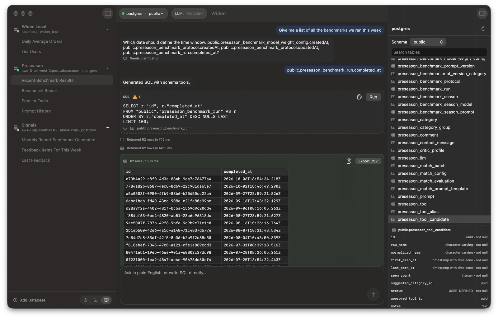

# Widen

[](https://github.com/betocmn/widen/actions/workflows/ci.yml)
[](https://github.com/betocmn/widen/actions/workflows/codeql.yml)
[](LICENSE)
[](CONTRIBUTING.md)

Open-source, native Postgres GUI for macOS. Ask questions in English; review
the SQL before it runs.



[Download for Mac](https://github.com/betocmn/widen/releases/latest/download/Widen.dmg)
· [Build from source](#build-and-run)
· [Privacy](PRIVACY.md)
· [Contributing](CONTRIBUTING.md)
· [Security](SECURITY.md)
· [Release notes](https://github.com/betocmn/widen/releases/latest)

`macOS 14+` · `Text-to-SQL: beta (Particle-1)` · `No backend` ·
`No account` · `MIT` · `Postgres-only MVP`

Widen is an open-source, native Postgres GUI for macOS 14+. It reads your
schema and can draft SQL from a question using Particle-1, a cloud model from
Particle, with your own Particle API key. It shows the SQL before anything
runs, so you can review or edit it first.

It is not an autonomous database agent. Widen drafts SQL, validates it, and
waits for you to decide whether to run it. Text-to-SQL is beta: it must pass a
published release gate before we describe it as production-ready, and
Particle-1 has not passed it yet — see
[why text-to-SQL is beta](#why-text-to-sql-is-beta-and-how-well-know-it-isnt).

## What leaves your Mac?

No Widen backend. No account. No analytics. Out of the box, Widen can browse
schemas and run manual SQL with only the PostgreSQL connection you configure.
Text-to-SQL uses Particle-1 and needs a Particle API key you add in
Settings › LLM.

| Feature | Schema/question | Query results | Notes |
| --- | ---: | ---: | --- |
| Text-to-SQL (Particle-1) | Your question and the schema metadata the connection allows go directly to Particle (`api.particle.ai`) with your key. Your first plain-English question in a session also names it. | Result rows stay on your Mac. Data inspection, if you turn it on for a connection, sends Particle row counts and column statistics; inspected values are sent only when that connection also allows it. | Database error messages are sent so Particle-1 can fix failed queries, and can quote a value from your data. Particle states it keeps no inference data by default; that is Particle's policy, not something Widen enforces. Turning off schema metadata sharing turns off text-to-SQL for that connection. |

Passwords and API keys live in the macOS Keychain, never on disk in plaintext.

## Why text-to-SQL is beta (and how we'll know it isn't)

Text-to-SQL ships behind a hard release gate: 60 pinned-model gate results
with at least 90% end-to-end semantic pass rate, 100% safety validity, 100%
schema validity, 100% clarification decision accuracy, at least 95% transport
reliability, and zero repeated-repair failures. Particle-1 failed the 0.2.0
gate, so text-to-SQL stays beta and should not be described as
production-ready until it passes.

Widen requests the `particle-1` model, and every response must report
`particle-ai/particle-1` or Widen discards it. Particle publishes no dated
snapshots, so that check verifies the model name only: Particle can update the
model behind it without a Widen release, and Widen cannot detect the change.
Instead of version pinning, the gate is rerun before each minor release and
whenever a model change is announced or observed.

We publish negative results: pre-registered, paid gate experiments that fail
their criteria are reverted and documented. See
[how we gate releases](docs/evals/how-we-gate.md) for the design and the
experiment log. Particle-1 gate evidence: the
[0.2.0 release-gate report](docs/evals/0.2.0.md) (failed: 25/60 end-to-end
semantic passes and 11/12 clarification decisions). The release passed its
[pre-registered regression check](docs/evals/0.2.0-regate.md); text-to-SQL remains
beta. The
[0.1.0 release-gate report](docs/evals/0.1.0.md)
covers the previous OpenRouter GPT-5.5 profile and is kept as history; that
gate failed on semantic pass rate. Run the gate yourself with
`make eval-release` and your own Particle API key; contributor-facing eval
mechanics live in [Evals/README.md](Evals/README.md). Manual SQL editing,
schema browsing, and normal database work don't need a Particle key.

## Review before run

Every statement, whether typed manually or drafted by the model, goes through
the same deterministic safety validator:

- One statement only.
- `SELECT`/`WITH` reads, or explicit `INSERT`/`UPDATE`/`DELETE` writes.
- No DDL, transaction keywords, semicolon chains, `pg_sleep`, `dblink`, or
  large-object calls.
- Statement timeouts and row caps apply at execution time.
- Writes are never auto-run, and Widen asks for confirmation before `DELETE`
  or an `UPDATE` without a `WHERE`.

If you only want reads, connect with a read-only Postgres user. The app-level
guardrails are useful, but database permissions are the real boundary.

## Install

Download the latest signed and notarized DMG:

```text
https://github.com/betocmn/widen/releases/latest/download/Widen.dmg
```

Open `Widen.dmg`, drag Widen into Applications, and launch it. Sparkle updates
are served from GitHub Releases.

| Requirement | Notes |
| --- | --- |
| macOS 14 or later | Required to install and launch Widen. |
| Particle API key | Optional, only needed for text-to-SQL. Get one at [platform.particle.ai](https://platform.particle.ai/) and add it in Settings › LLM. |
| PostgreSQL | Widen is Postgres-only today. [Postgres.app](https://postgresapp.com) works well for local testing. |
| Xcode 26 or later | Needed when building from source. |

## Sample database for exploring the app

This is only for trying the app by hand — the integration tests (`make test-db`)
provision and drop their own throwaway databases and do not need it.

With Postgres.app running (its default server on `localhost:5432`):

```sh
createdb widen_test
psql -d widen_test -f scripts/sample_db.sql
```

If `psql` is not on your PATH, use the bundled one, e.g.
`/Applications/Postgres.app/Contents/Versions/17/bin/psql`.

The script creates a tiny shop dataset:

```sql
CREATE TABLE users (
  id SERIAL PRIMARY KEY,
  email TEXT NOT NULL,
  name TEXT,
  created_at TIMESTAMPTZ NOT NULL DEFAULT now()
);

CREATE TABLE orders (
  id SERIAL PRIMARY KEY,
  user_id INTEGER NOT NULL REFERENCES users(id),
  total_cents INTEGER NOT NULL,
  status TEXT NOT NULL,
  created_at TIMESTAMPTZ NOT NULL DEFAULT now()
);
```

plus a few rows. Good first questions to try:

- "Show me all users."
- "Show the 10 most recent orders."
- "Which users have spent the most?"
- "Count orders by status."
- "Show revenue by day."
- "Show customers with no orders."

## Connecting

On first launch, click Add Database to open Settings › Databases. For a
default Postgres.app setup: host `localhost`, port `5432`, database
`widen_test`, username = your macOS username, empty password (Postgres.app
uses trust auth locally), SSL mode Disabled. Add as many databases as you like
with the "+" button; deleting one warns you first — its sessions are deleted
with it.

Postgres.app asks once per client app before allowing a connection. If a
connection seems to hang, check Postgres.app's Settings > Client Applications
and allow Widen.

> **Safety tip:** Widen runs the SQL you approve, including writes — it never
> auto-runs a write, and DELETE or UPDATE-without-WHERE asks you to confirm
> first. If you only want reads, connect with a read-only Postgres user; defense
> in depth is cheap.

Non-secret connection settings are stored in
`~/Library/Application Support/Widen/connections.json`; passwords are stored
in the macOS Keychain (service `Widen`).

## Built for people who live in Postgres

Widen is a lightweight, native Postgres workbench for browsing schemas, keeping
query sessions, and turning questions into SQL:

- Configure any number of PostgreSQL connections in Settings.
- Browse the selected database's schemas, tables, columns, types, and foreign
  keys in the inspector.
- Keep persistent chat + SQL + results sessions that survive restarts.
- Draft SQL from plain-English questions with Particle-1; the toolbar's
  Particle-1 chip shows whether text-to-SQL is ready and opens Settings › LLM.
- Use a modern macOS interface with light/dark appearance and Liquid Glass on macOS 26+.

## Known limitations

- PostgreSQL only.
- Early MVP, not full DataGrip/TablePlus/Postico feature parity.
- Text-to-SQL is beta and needs your own Particle API key. There is no
  offline or on-device text-to-SQL.
- The model is fixed to Particle-1; there is no model picker. Particle can
  change the model's behavior without a Widen release, and Widen verifies
  only the model name each response reports (`particle-ai/particle-1`), not
  a dated version.
- Connections that turn off schema metadata sharing can't use text-to-SQL.
- Paste Details… fills a connection from a connection URL, `.env`-style
  `KEY=VALUE` lines, or a JSON object, parsed on your Mac with fixed rules.
  Free-form prose is not understood.
- Results are rendered as text values; typed grid behavior is still limited.
- Export is CSV-only today.
- No SQL syntax highlighting yet.
- Query results are not persisted across restarts. Transcripts, SQL text, and
  generation metadata are persisted; rerun a session's query to repopulate the
  grid.

## Sessions

Each database in the sidebar lists its query sessions. Selecting the
database itself opens its schema in the inspector; press the hover "+"
(or Cmd+N) to start a session — the database connects lazily, so nothing
happens until a session or schema browse needs it. A session keeps its chat
transcript (including run records), active SQL, and generation metadata in
`~/Library/Application Support/Widen/sessions.json` (query results are
deliberately not persisted). If your first message is a plain-English
question, a Particle key is set, and the connection allows schema metadata
sharing, Particle-1 names the session from that question alone; otherwise, or
if that request fails, the name is the message's first words. Rename it
manually (right-click › Rename) and the auto-name never overwrites yours.
Right-click › Archive hides a session; restore it or delete it forever from
Settings › Archived Sessions.

The schema browser lives in a right-hand inspector — toggle it from the
toolbar. The toolbar breadcrumb (`database › schema`) and the inspector's
picker both switch the open schema; the table list and the AI's context are
scoped to it. Schema snapshots are cached in
`~/Library/Application Support/Widen/schemas.json` so the last known schema is
available immediately on relaunch; Refresh Schema fetches the live structure
and updates that cache. The sun/moon button in the sidebar footer flips
light/dark mode; pick "System" in Settings › General to follow macOS again.

## How a query runs

1. You type into the composer: a plain-English question, or raw SQL
   (`SELECT`/`WITH` reads and SQL-shaped `INSERT INTO`, `UPDATE ... SET`, or
   `DELETE FROM` writes skip the model entirely).
2. For questions, Widen's schema-tool agent sends Particle-1 the question,
   the selected schemas, and the safety rules. Particle-1 looks up the tables,
   columns, types, constraints, and foreign keys it needs through bounded
   schema tools that Widen answers from the open schema (system schemas
   excluded), plus data inspection tools when the connection allows them. It
   then submits either one SQL statement or a clarification question, within
   fixed budgets (12 model turns, 12 schema lookups and 180 s); a run that
   runs out of budget or time is asked for its final answer instead.
3. A word check matches your question against the schema the SQL uses, the
   connection's database context, and definitions you confirmed. If a word
   matches nothing, Widen may ask Particle-1 in a separate request whether it
   needs a definition; that request carries the question, the unmatched words
   and schema metadata, never the SQL or data values. Widen checks the
   answer's citations itself and keeps the SQL only when every word checks
   out; otherwise it asks you what the word means.
4. The SQL appears in the chat as a dashed card, validated deterministically:
   only one read or `INSERT`/`UPDATE`/`DELETE` statement, no semicolons, no
   DDL/transaction keywords, no `pg_sleep`/`dblink`/`lo_*`. Validation issues
   sit behind the card's status icon. Keep chatting (or paste corrected SQL)
   until it's right.
5. Run executes reads in a `BEGIN READ ONLY` transaction and writes in a normal
   transaction with `SET LOCAL statement_timeout` (default 10s). Read queries
   without a `LIMIT` are wrapped in a subquery with your default row limit
   (default 100).
6. The results flow into the same chat thread: a bordered table card appears
   where the run happened (first 10 rows, "View more" for the rest), with
   Copy as CSV and Export CSV. Every run is recorded in the transcript, and
   the conversation just keeps going underneath.

Keyboard: **Enter** in the composer submits (Option+Enter for a newline);
**Cmd+Enter** runs the active SQL; **Cmd+N** starts a new session; **Cmd+R**
refreshes the active database's schema; **Cmd+,** opens Settings.

## Build and run

Setup, Make targets, and release scripts share Xcode discovery: an explicit
`DEVELOPER_DIR` takes priority, followed by the full Xcode selected by
`xcode-select`, `/Applications/Xcode.app`, and other `/Applications/Xcode*.app`
installations. Xcode 26 or later is required; Xcode 27 is supported, and older
Xcode installations are skipped. To choose a different installation, use
`make build DEVELOPER_DIR=/path/to/Xcode.app/Contents/Developer`.

If no Xcode 26 or later installation is found, Conductor setup skips package
resolution and leaves the workspace available for editing. Command Line Tools
or an older Xcode cannot build or test the app. After installing Xcode, rerun
`bash .conductor/setup.sh`. Setup and the normal build/test commands do not
require a Particle API key or any other LLM credentials.

```sh
make project   # regenerate Widen.xcodeproj from project.yml (needs xcodegen)
make build     # build the app (Debug)
make run       # build and launch Widen.app
make test      # unit tests
make test-db   # unit + Postgres integration tests (needs a local Postgres server)
make xcode     # open the project in the selected Xcode
```

The committed `Widen.xcodeproj` is generated - edit `project.yml` and run
`make project` instead of editing project settings by hand. If you open the
project in Xcode directly, use **Xcode 26 or later**. Widen targets macOS 14,
while Liquid Glass styling is compiled behind macOS 26 availability checks.

## Release packaging

Release packaging is automated for Developer ID distribution. Debug stays ad-hoc
signed for local development. The release script reads local signing,
notarizing, bundle ID, and Sparkle values from environment variables or
`.env.release.local`:

```sh
cp .env.release.example .env.release.local
make release-mac
```

See [docs/release.md](docs/release.md) for the full signed DMG, Sparkle, and
static website release runbook.

For codebase onboarding, implementation details, and development caveats
(local code signing, sandbox status, SSL modes), see
[docs/implementation-guide.md](docs/implementation-guide.md).

## Open source

Widen is MIT licensed and developed in the open. Start with
[CONTRIBUTING.md](CONTRIBUTING.md) for local setup, testing expectations, and
the safety/privacy rules contributors should preserve. See
[PRIVACY.md](PRIVACY.md) for the data-flow summary and [SECURITY.md](SECURITY.md)
for vulnerability reporting.

## License

MIT - see [LICENSE](LICENSE).
